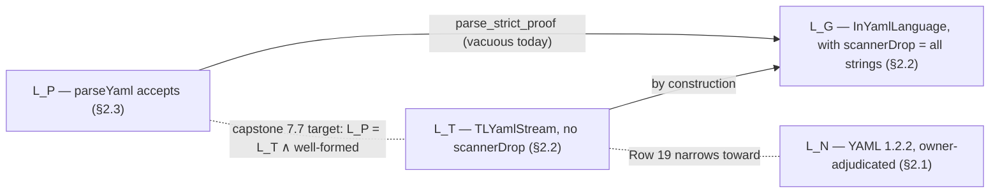
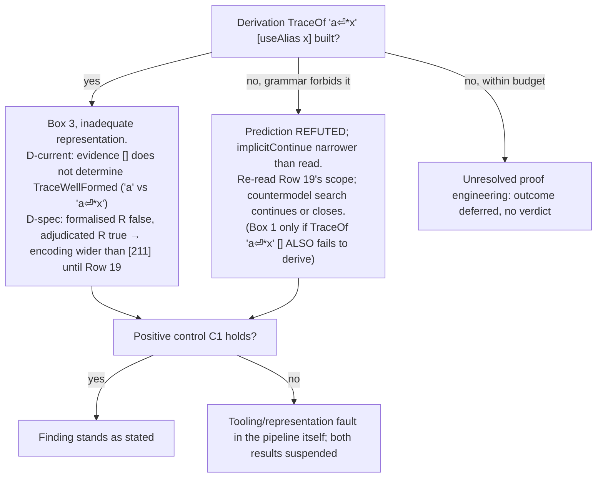

# EXPERIMENT.md — a proof-adequacy audit of one scanner-to-trace obligation

**Status:** discussion draft, to be iterated between Nicolas Rouquette (L4YAML
owner) and Heath Sanchez (Metalogic Labs / MathGraph, auditor).  Nothing in this
document is a result; it is the *design* of an experiment.  Where it reports a
fact about the tree it names the file and declaration the fact is read from.

**Source of the proposal:** H. Sanchez, *Proof Adequacy Audits: What Verified
Software Can Actually Establish*, draft of 9 November 2026, §6 "L4YAML: proposed
diagnosis of the actual proof frontier".  The paper's closing paragraph of §6
is the brief this document answers:

> Proposed collaborative experiment, subject to Nicolas's choice: freeze one
> concrete scanner-to-`TraceOf` obligation and its legitimate input domain,
> identify the exact consuming capstone theorem, and test a minimum
> countermodel plus a positive control.  The outcomes are distinct: a refuted
> obligation, a proven local bridge with a still-open global step, a
> demonstrably inadequate representation, or an unresolved proof-engineering
> task.  No conclusion about the whole approach follows from a failed bounded
> search.  Nicolas can accept, change, or decline the audit domain, adequacy
> predicate and resource budget.

**Tree this draft is pinned to:** branch `experiment/metagraph`, a copy of
`fix-a-grammar-completeness` at `e3efcc26` (merge of #277), toolchain
`leanprover/lean4:v4.35.0` (`lean-toolchain`).  Every file path below is
relative to the repository root at that revision.  The experiment itself must
re-pin to whatever revision it runs on (§7).

---

## 0. Summary

### 0.1 The target: `SerializationWellFormed input`

The capstone this experiment serves is Blueprint row 7.7, `parse_iff_grammar`
(§3.3), as stated in `Blueprint/ledgers/parse_iff_grammar/2026-10-29.md`:

```lean
theorem parse_iff_grammar (input : String) :
    (∃ docs, parseYaml input = .ok docs)
      ↔ ExactSurfaceLanguage input ∧ SerializationWellFormed input
```

Its right-hand side has two parts:

- `ExactSurfaceLanguage input` — the input has a *shape* YAML 1.2.2 admits:
  some derivation of the surface grammar produces it.
- `SerializationWellFormed input` — *every* reading the grammar gives the
  input is well-formed as a serialization: each anchor is defined before an
  alias uses it, each tag handle is declared before it is used, each document
  starts with a fresh environment.

**The experiment is about `SerializationWellFormed input` only.**  Three facts
about that name:

- In the ledger statement it is applied to a `String`.  No declaration of that
  type exists in the tree.
- The tree's `SerializationWellFormed : List Event → Prop` (§2.2) is the
  *event-level* relation.  The string-level property the ledger statement
  intends is spelled `TraceWellFormed input` (§2.4):
  `∀ ev, TraceOf input ev → SerializationWellFormed ev`.
- Throughout this document **the target** means `TraceWellFormed input`, read
  as the ledger's `SerializationWellFormed input`.

Why `ExactSurfaceLanguage input` is left out:

- It is a different frontier with its own campaign.  `ExactSurfaceLanguage` is
  not declared either; it is `InYamlLanguage` after Row 12 retires
  `scannerDrop`, Row 19 narrows `implicitContinue`, and the seven-item 5a(ii)
  worklist narrows the directive productions.  Its forward direction is already
  a Lean-checked theorem on the current, over-approximated grammar
  (`parse_strict_proof`, capstones 7.1–7.6) and is re-proven each time the
  grammar narrows (ledger row F1).
- It is not what §6 of the paper names.  The paper's obligation is
  scanner-to-`TraceOf`, and `TraceOf` feeds only the `SerializationWellFormed`
  side of 7.7 (the chain in §3.3).
- The adequacy question of §0.2 only arises on the `SerializationWellFormed`
  side.  `ExactSurfaceLanguage` is an *existence* statement (some derivation
  produces the input), so one derivation is all the evidence it needs.
  `TraceWellFormed` is *universal* (every derivation's trace is well-formed),
  and the scanner only ever supplies one.  That `∃ → ∀` gap is the subject.

### 0.2 The question, with an example

The experiment asks a sharper question than "is the proof done":

> At this one boundary, does the **evidence** the proof consumes **determine**
> the **requirement** the capstone states?

Spelled out for this boundary:

- The **evidence** is what the proof chain actually looks at: the scanner's
  token stream `ts`, read as a trace `tokenEvents ts`, and the verdict
  `checkFrom {} (tokenEvents ts)` on it.  Nothing else about the input reaches
  the capstone through this chain.
- The **requirement** is the target, `TraceWellFormed input`: *every* trace the
  grammar assigns to the input is well-formed.
- The evidence **determines** the requirement if two inputs with the same
  evidence always get the same requirement verdict.  If one pair of inputs has
  identical evidence but opposite verdicts, the evidence is *inadequate*: no
  proof that only consumes that evidence can conclude the requirement, however
  many lemmas are green.

The concrete pair this experiment proposes to test (§4):

| Input | Evidence: `tokenEvents ts` | `checkFrom` on it | Requirement: `TraceWellFormed` under the current grammar |
|---|---|---|---|
| `a` | `[]` | true | true — the only trace is `[]` |
| `a⏎*x` | `[]` (the scanner folds it into the plain scalar `a *x`) | true | **predicted false** — the grammar also admits a bare second document `*x`, whose trace `[useAlias "x"]` names an undefined anchor |

Same evidence, opposite verdicts.  If the prediction holds, the chain in §3.3
cannot reach `TraceWellFormed` from `checkFrom` on the current grammar, not
because a lemma is missing but because the evidence does not carry the
information.  The positive control (§5) is a fragment where the opposite is
proven: on flow collections the grammar assigns one trace, so the scanner's
evidence does determine the requirement there.

### 0.3 The plan on the tree, in two steps

The project plans to discharge the target in **two steps**:

1. `scan_trace` (the "S3 bridge"; **the obligation** this experiment freezes):
   `scanFiltered input = .ok ts → TraceOf input (tokenEvents ts)`.  The
   scanner's own token stream, read as a trace, is *one* trace the grammar
   assigns to the input.
2. `traceOf_unique` (the "lift"):
   `TraceOf input ev₁ → TraceOf input ev₂ → ev₁ = ev₂`.  It is the *only* such
   trace, so checking the scanner's trace checks every trace.

Where each step stands today:

1. `scan_trace` is **proven** slice by slice (leaves, document markers, flow;
   §3.1) and **gated** at the whole-stream level until the grammar constructor
   `scannerDrop` is retired (Row 12).
2. `traceOf_unique` is **proven** on flow collections and **refuted** on the
   block/document fragment of the current grammar by a checked counterexample
   (`traceOf_unique_refuted`; §3.2).

### 0.4 What the experiment does

- Freezes **the obligation** — `scan_trace`, step 1 of §0.3 — and **its
  consumer** — the target `TraceWellFormed input` of capstone 7.7, which
  `scan_trace` reaches only through step 2 (the chain is written out in §3.3).
- Fixes a legitimate input domain \(D\) (§3.5).
- Runs one minimum **countermodel** (§4).  *Countermodel to what:* to the
  adequacy of the evidence (§0.2) — an input inside \(D\) on which the
  scanner's trace passes `checkFrom` yet the target `TraceWellFormed` is
  false.  It is not a countermodel to `scan_trace` itself, which is expected
  to hold on it.
- Runs one **positive control** (§5).  *Control of what:* of the same property,
  `TraceWellFormed`, on an input where it is known to hold by an independent
  argument (flow collections, where `traceOf_unique` is a lemma), run through
  the same pipeline.  It shows that a negative result on the countermodel comes
  from the input and not from the harness.
- Places the outcome in exactly one of four boxes (§7), and in no other:
  - **refuted obligation** — `scan_trace` is false on \(D\);
  - **local proof with an open global step** — `scan_trace` holds on \(D\),
    the lift to `TraceWellFormed` does not;
  - **inadequate representation** — the evidence `scan_trace` delivers cannot
    determine the target on \(D\), whatever else is proven;
  - **unresolved proof engineering** — nothing refuted, nothing inadequate,
    the proof is not finished.

---

## 1. Why this experiment and not another

The paper's thesis: a green proof artefact can fail to *establish* an external
requirement for three distinct reasons.  This document calls them the three
**failure modes**:

- **Refutation** — the claim is false as stated.
- **Inadequacy** — the observations the proof relies on do not determine the
  requirement (§0.2).
- **Engineering** — the proof is simply unfinished.

An audit that does not tell the three failure modes apart ends in one of two
wrong results:

- an **overclaim** — "the build is green, therefore the parser is conformant" —
  which treats engineering progress as establishing the requirement;
- an **overcorrection** — "the statement is false, therefore the approach is
  unsound" — which treats one failed bounded search as a verdict on the
  method.

L4YAML is a good subject because all three failure modes are visibly present
at one boundary, documented in the tree itself:

| Failure mode | Where it is already visible in the tree |
|---|---|
| Refutation | `Tests/Guards/Proofs/TraceOfBlockAmbiguity.lean` proves `traceOf_unique_refuted`: the input `a⏎&x` has two traces, `[]` and `[defineAnchor "x"]`. |
| Inadequacy (representation / over-approximation) | `L4YAML/Surface/Document.lean`: the constructor `SLYamlStream.scannerDrop` makes `InYamlLanguage s` true for every string (the source comment says so), so `parse_strict_proof` is vacuous until Row 12 retires it. |
| Engineering | `DOCS.md` items 454–468: the S3 bridge is priced, its leaf, document-marker and flow slices are paid, the whole-stream statement is gated. |

---
## 2. Vocabulary

Four layers are in play, and the same English word ("trace", "well-formed",
"language") means something different at each.  The categories below keep them
apart; each entry is pinned to the spec section or the Lean declaration it
names.

### 2.1 The YAML 1.2.2 language and its specification

Terms that exist independently of L4YAML.

| Term | Meaning | Where in the spec |
|---|---|---|
| **production `[n]`** | The spec's grammar is numbered `[1]`–`[211]`; `[211] l-yaml-stream` is the whole input. | YAML 1.2.2 ch. 5–9 |
| **plain scalar** | An unquoted scalar such as `a` or `hello world`.  A plain scalar may *continue onto the next line*: `a⏎b` is the single scalar `a b`.  `*` and `&` are ordinary characters in a continuation line. | §7.3.3 (`ns-plain-multi-line`) |
| **anchor / alias** | `&x` names the following node; `*x` refers to a node named earlier.  An alias must be preceded by its anchor. | §6.9.2, §7.1 |
| **tag handle / `%TAG` directive** | `!e!` is a handle; `%TAG !e! tag:example.com,2000:` declares it for the following document; `!e!foo` uses it. | §6.8.2 |
| **document markers** | `---` starts, `...` ends a document.  A *bare* document has neither.  Without a marker, a second document may not follow a first. | §9.1 |
| **serialization tree / well-formedness** | The spec's intermediate representation in which anchors, aliases and tags are explicit; its constraints (alias after anchor, handle declared) are what "well-formed trace" encodes. | §3.2.2 |
| **`c-printable`, SOH** | `[1] c-printable` is the set of characters allowed in a YAML stream.  SOH (U+0001, Start of Heading) is outside it; the paper uses a raw SOH as the string that the current `InYamlLanguage` admits and the scanner refuses. | §5.1 |
| \(L_N\) | *The normative language*: the set of streams YAML 1.2.2 accepts, as the owner adjudicates ambiguous passages.  Not a Lean object. | — |

### 2.2 L4YAML's encoding of the language

The spec, transcribed into Lean as *relations* (inductive predicates).  These
say what the language **is**; they do not compute anything.

| Term | Meaning | Pinned to |
|---|---|---|
| **surface grammar** | Productions `[1]`–`[211]` as inductive relations on positions (`SurfPos` = remaining characters + column).  `SLYamlStream` is `[211]`. | `L4YAML/Surface/*.lean` |
| **`InYamlLanguage s`** | `∃ s', SLYamlStream ⟨s.toList, 0⟩ s' ∧ s'.chars = []` — the surface grammar consumes all of `s`. | `L4YAML/Surface/Document.lean` |
| **`scannerDrop`** | A fourth constructor of `SLYamlStream`, not in the spec, that lets a derivation skip arbitrary input.  Reason `InYamlLanguage` holds for every string today.  Retiring it is **Row 12**. | `L4YAML/Surface/Document.lean` |
| **`implicitContinue`** | The `[211]` constructor letting a bare document follow another.  Wider than the spec (§9.1 allows this only after `---`/`...`).  Source of the trace ambiguity.  Narrowing it is **Row 19**. | `L4YAML/Surface/Document.lean`; `DOCS.md` Row 19 |
| **`@[yaml_spec]`** | Attribute linking each Lean definition to the production number it transcribes — the tree's only machine-readable tie to \(L_N\). | `L4YAML/Spec/YamlSpec.lean` |
| **`Event`, trace** | The serialization-relevant actions in order: `beginDocument`, `endDocument`, `defineAnchor n`, `useAlias n`, `declareTag h`, `useTag h`.  A *trace* is a `List Event`.  Scalars and collections leave no event. | `L4YAML/Proofs/Serialization/SerializationWellFormed.lean` |
| **annotated grammar, `TLYamlStream s s' ev`** | The surface grammar with each span carrying the trace it emits.  Has the three spec constructors of `[211]` and **not** `scannerDrop`. | `L4YAML/Proofs/Serialization/TraceOf/{Document,Leaves,Node}.lean` |
| **`TraceOf input ev`** | `∃ col, TLYamlStream ⟨input.toList, 0⟩ ⟨[], col⟩ ev` — "`ev` is a trace of `input`".  An *existence* statement: an input may have several traces. | `TraceOf/Document.lean` |
| **`SerializationWellFormed ev`** | The spec's serialization constraints as a predicate on traces: every alias names an anchor defined earlier in the same document, every tag handle used was declared, documents reset the environment. | `SerializationWellFormed.lean` |
| \(L_G\) | *The internal grammar's language*: `{ s \| InYamlLanguage s }`.  Currently all strings (`inYamlLanguage_everything`, `Tests/Guards/Proofs/SuffixGapAudit.lean`). | — |
| \(L_T\) | *(not in the paper — added here)* `{ s \| ∃ ev, TraceOf s ev }`: the `scannerDrop`-free annotated grammar's language.  What the trace obligation is stated against; what Row 12 would make `InYamlLanguage` equal to.  Still wider than \(L_N\) through `implicitContinue`. | — |

### 2.3 L4YAML's implementation of the spec

Executable functions — what actually runs.

| Term | Meaning | Pinned to |
|---|---|---|
| **scanner, `scanFiltered`** | `String → Except ScanError (Array (Positioned YamlToken))`.  The lexer; first stage of the parser; the function the obligation is about. | `L4YAML.Scanner.scanFiltered`, `L4YAML/Scanner/Scanner.lean` |
| **token** | `YamlToken`: `scalar text style`, `anchor n`, `alias n`, `tag …`, `documentStart`, `flowSequenceStart`, …  The scanner's output unit. | `L4YAML/Token/Token.lean` |
| **parser, `parseStream`, `parseYaml`** | `parseStream : Array (Positioned YamlToken) → Except … (Array YamlDocument)`; `parseYaml` = `scanFiltered` then `parseStream`. | `L4YAML.TokenParser.parseYaml`; factorisation in `L4YAML/Proofs/Serialization/ExecutableBoundary.lean` |
| **`tokenEvents ts`** | The scanner's token array read as a trace: `anchor n ↦ defineAnchor n`, `alias n ↦ useAlias n`, `%TAG` ↦ `declareTag` flushed at `---`, … | `L4YAML/Proofs/Serialization/TokenEvents.lean` |
| **`checkFrom env ev`** | Executable decision procedure for `SerializationWellFormed` (a `Bool`). | `SerializationWellFormed.lean` |
| **`refLex`** | A reference lexer written independently of the scanner; executable census oracle in Priority 99.  Not a proof artefact. | `L4YAML/Proofs/Serialization/RefLex.lean`, `EventsOf.lean` |
| \(L_P\) | *Executable acceptance*: `{ s \| ∃ docs, parseYaml s = .ok docs }`. | — |

### 2.4 L4YAML's formalization of the spec

Properties **about** the functions of §2.3, stated using the relations of §2.2.

| Term | Meaning | Pinned to |
|---|---|---|
| **`scan_trace`** (the S3 bridge) | `scanFiltered input = .ok ts → TraceOf input (tokenEvents ts)`.  The scanner's trace is a trace of the input.  Stated and priced in item 454; proven by slice (§3.1). | `DOCS.md` item 454; `TraceOf/{LeafBridge,DocBridge,FlowBridge}.lean` |
| **`traceOf_unique`** (the lift) | `TraceOf input ev₁ → TraceOf input ev₂ → ev₁ = ev₂`.  Proven on flow; refuted on block/document (§3.2). | `TraceOf/UniqueFlow.lean`; `Tests/Guards/Proofs/TraceOfBlockAmbiguity.lean` |
| **`TraceWellFormed input`** | `∀ ev, TraceOf input ev → SerializationWellFormed ev`.  *Universal* over all traces.  The target (§0.1): the string-level reading of the capstone's `SerializationWellFormed input`. | `TraceOf/Document.lean` |
| **`serializationWellFormed_iff_check`** | `SerializationWellFormed ev ↔ checkFrom {} ev = true` — ties the relation (§2.2) to the executable (§2.3). | `SerializationWellFormed.lean` |
| **`scanFiltered_parseStream_ok_checkFrom_full`** (S5→) | `scanFiltered input = .ok ts → parseStream ts = .ok docs → checkFrom {} (tokenEvents ts) = true`. | `L4YAML/Proofs/Serialization/ScannerShape.lean` |
| **`parse_strict_proof`** | `parseYaml input = .ok docs → InYamlLanguage input`.  Today's end of the chain; vacuous while `scannerDrop` stands. | `L4YAML/Proofs/Production/DocumentProduction.lean` |
| **capstone** | One of the numbered end-to-end theorems in `Blueprint/04-capstones.md`.  Only capstones are declared `theorem`; everything else is `lemma`. | `Blueprint/04-capstones.md`, `AGENTS.md` |
| **`parse_iff_grammar`** (capstone 7.7) | `(∃ docs, parseYaml input = .ok docs) ↔ ExactSurfaceLanguage input ∧ SerializationWellFormed input`.  Stated in the ledger; not yet declared. | `Blueprint/ledgers/parse_iff_grammar/2026-10-29.md` |
| **Rule 2 / Priority *N*** | Every statement is first *instantiated adversarially* — executed on a grid of concrete inputs with predictions written down beforehand — before any proof is attempted.  Grids are numbered `Priority N`. | `Blueprint/06-discipline.md`; `Tests/AdversarialInstantiation.lean` |
| **closure log, item *N*** | `DOCS.md`'s append-only record; one item per landed PR.  Item 454 is where `scan_trace` was stated and priced. | `DOCS.md` |

### 2.5 The paper's terms, as used in this experiment

| Term | Meaning in this experiment |
|---|---|
| **claim** | A proposition about L4YAML's artefacts, in Lean, with every definition fixed at a pinned revision.  Here `scan_trace` (§3.1), and through it `TraceWellFormed`. |
| **requirement** | What Nicolas actually wants to be true of the parser, stated without reference to how the proof is organised: *every input `parseYaml` accepts has only well-formed serialization traces, as YAML 1.2.2 reads it.* |
| **authority** | Who decides when the spec and a formalisation disagree.  For L4YAML the owner adjudicates against YAML 1.2.2 (the paper's "owner-adjudicated interpretation"). |
| **observation / evidence** | The data the proof consumes to decide the requirement.  Here: the scanner's token array `ts` and its reading `tokenEvents ts`. |
| **adequacy** | The observation *determines* the requirement on the admissible domain: two inputs with the same observation never differ on the requirement (§0.2).  Inadequacy is witnessed by one pair that agree on the observation and disagree on the requirement. |
| **witness** | A concrete input (or pair) whose behaviour is checked by execution or by a kernel-checked derivation, not asserted. |
| **evidence boundary** | The edge of what a given artefact establishes.  `scan_trace` establishes *existence* of a well-formed trace; the boundary is the `∃ → ∀` step, which no scanner fact can cross on its own. |
| **representation** | How the requirement is encoded (§2.2): the annotated grammar `TLYamlStream` and the `Event` type.  A representation is *inadequate* when the encoding itself loses or adds information relative to the requirement — not merely when a proof is missing. |
| **admissibility** | Whether an input belongs to the domain the claim is about.  An input outside the domain refutes nothing, however badly it behaves. |
| **validity** | The period and conditions under which a recorded outcome stands: a source revision, a toolchain, and the absence of withdrawn evidence.  Any change re-opens the outcome (§7). |
| **positive control** | An input on which the claim is known to hold by an independent argument, run through the same pipeline, to show that a negative outcome elsewhere is not a tooling artefact. |

### 2.6 The three languages, side by side

The paper distinguishes \(L_N\), \(L_G\), \(L_P\) and asks that the distinction
be made at the start.  With the layers above (and the added \(L_T\)):



A theorem `L_P = L_T` (what row 7.7 aims at) is an internal-consistency
result.  A YAML-conformance claim additionally needs `L_T = L_N`, which is a
separate audit of the surface transcription (§2.2 against §2.1) and is **out of
scope here**.  The experiment uses \(L_N\) only as the *authority* for whether a
countermodel is admissible (§4.3).

---

## 3. The frozen obligation

### 3.1 The claim

Item 454 of the closure log states the S3 bridge as

```lean
scan_trace :
  scanFiltered input = .ok ts → TraceOf input (tokenEvents ts)
```

Unfolding `TraceOf` (`TraceOf/Document.lean`):

```lean
scanFiltered input = .ok ts →
  ∃ col, TLYamlStream ⟨input.toList, 0⟩ ⟨[], col⟩ (tokenEvents ts)
```

In words: *whenever the scanner accepts an input, the token stream it produced,
read as a trace, is a trace the annotated grammar assigns to that input.*

Current state (from `DOCS.md` items 454, 459–468 and the `TraceOf/` modules):

| Slice | Status | Where |
|---|---|---|
| Leaf properties (`&x`, `*x`, `!tag`) | paid | `TraceOf/LeafBridge.lean` (`scanAnchorOrAlias_trace`, `scanTag_trace`) |
| Document markers and `%TAG` flush algebra | paid | `TraceOf/DocBridge.lean`, `TokenEvents.lean` |
| Flow collections | paid through the close-base landing (#277); the remaining step is `accum_step_flow_trace` (item 468) | `TraceOf/FlowBridge.lean`, `FlowWalk.lean` |
| Whole stream | **gated**: the only existing producer of a stream derivation for scanner output, `StreamAccum.scanLoop_grammar_prod`, applies `scannerDrop` at two sites, and `TLYamlStream` has no such constructor | `TraceOf/Document.lean` header; item 454 |

### 3.2 The lift the consumer needs

`scan_trace` yields one trace.  The target (§0.1) is over all traces:

```lean
def TraceWellFormed (input : String) : Prop :=
  ∀ ev, TraceOf input ev → SerializationWellFormed ev
```

The project's intended bridge from one to all is

```lean
traceOf_unique :  TraceOf input ev₁ → TraceOf input ev₂ → ev₁ = ev₂
```

| Fragment | `traceOf_unique` status | Where |
|---|---|---|
| Flow (`[ … ]`, `{ … }`, properties, aliases) | **proven** | `TraceOf/UniqueFlow.lean` (`tFlowSequence_unique`, `tFlowMapping_unique`, `tCNsProperties_unique`, …) |
| Block / document | **refuted** on the current grammar; expected to close when Row 19 narrows `implicitContinue` | `Tests/Guards/Proofs/TraceOfBlockAmbiguity.lean` (`traceOf_unique_refuted`) |

### 3.3 The exact consumer

Capstone 7.7, as stated in `Blueprint/ledgers/parse_iff_grammar/2026-10-29.md`
and in `DOCS.md`'s "Grammar completeness" row:

```lean
theorem parse_iff_grammar (input : String) :
    (∃ docs, parseYaml input = .ok docs)
      ↔ ExactSurfaceLanguage input ∧ SerializationWellFormed input
```

**The authoritative row is being corrected to this statement.**  At the
pinned tree the row for 7.7 in `Blueprint/04-capstones.md` still reads
*"`parse_iff_grammar` converse — grammar completeness: `InYamlLanguage input →
∃ docs, parseYaml input = .ok docs`"*, the pre-2026-09-28 statement, while
`DOCS.md` and the ledger record that statement as **REFUTED** (`parseYaml`
enforces anchor/alias and tag-handle conditions the surface language cannot
express; and `inYamlLanguage_everything` in
`Tests/Guards/Proofs/SuffixGapAudit.lean` makes its hypothesis true of every
string) and state the biconditional above.  Rule 5 of
`Blueprint/06-discipline.md` makes the blueprint the winner when plan and
blueprint disagree, so the fix is to the blueprint, not to this document:
PR #284 (`docs/capstone-7-7-row`, against `fix-a-grammar-completeness`)
restates row 7.7 as `ExactSurfaceLanguage input ∧ TraceWellFormed input →
∃ docs, parseYaml input = .ok docs` — the second conjunct spelled as the
tree's input-level predicate (§0.1), not as the ledger's shape-only
`SerializationWellFormed input` — closing the biconditional above, and keeps
the `InYamlLanguage` form in the row marked REFUTED.  Once it lands
the three sources agree and the consumer below is the blueprint's own
statement; the pinned `experiment/metagraph` tree picks it up when it is
fast-forwarded (open question 10).

Its forward direction's `SerializationWellFormed input` part is discharged by the chain
(item 454, "Rule 1 — the chain"):

```text
parseYaml input = .ok docs
  ─ parseYamlRaw_ok_decompose (Composition.lean) ─▶  scanFiltered input = .ok ts ∧ parseStream ts = .ok docs
  ─ S5(→) scanFiltered_parseStream_ok_checkFrom_full (ScannerShape.lean) ─▶  checkFrom {} (tokenEvents ts) = true
  ─ serializationWellFormed_iff_check ─▶  SerializationWellFormed (tokenEvents ts)
  ─ scan_trace (S3, THIS OBLIGATION) ─▶  TraceOf input (tokenEvents ts)
  ⟹  ∃ ev, TraceOf input ev ∧ SerializationWellFormed ev          -- existence form
  ─ traceOf_unique (THE LIFT) ─▶  TraceWellFormed input              -- what 7.7 states
```

Today the chain's last link is `parse_strict_proof`
(`L4YAML/Proofs/Production/DocumentProduction.lean`), which concludes only
`InYamlLanguage input` — the \(L_G\) membership that `scannerDrop` makes
trivial.  Nothing in the tree currently consumes `TraceWellFormed`; the owner's
rule (EVENTSOF §10) is that no interim `∃`-shaped twin of 7.7 enters the
capstone table.  **The consumer is therefore a stated, not yet declared,
theorem**, and the experiment must say so rather than point at
`parse_strict_proof`.

> *Is this about a theorem, a lemma, or a requirement?*  All three, at
> different layers: `scan_trace` and `traceOf_unique` are lemmas (project
> convention); `parse_iff_grammar` is the theorem that consumes them; the
> requirement is the English sentence in §2.5 that the theorem is meant to
> encode.  The experiment tests whether the lemmas' evidence can reach the
> theorem, and whether the theorem's encoding reaches the requirement.

### 3.4 Observation, requirement, adequacy predicate

| Role | Instance |
|---|---|
| Observation \(T(x)\) | `tokenEvents ts` where `scanFiltered x = .ok ts` — exactly what S5(→) hands to `checkFrom`.  (Variant: the full token array `ts`; it carries more, e.g. scalar text, but S5 does not use the extra.) |
| Requirement \(R(x)\) | `TraceWellFormed x`, adjudicated against YAML 1.2.2 where the grammar and the spec disagree. |
| Adequacy predicate | \(\forall x, y \in D.\; T(x) = T(y) \Rightarrow (R(x) \Leftrightarrow R(y))\): the observation determines the requirement — *some* function of \(T(x)\) decides \(R(x)\). |
| Pointwise agreement (what the chain in §3.3 actually needs) | \(\forall x \in D.\; \texttt{checkFrom \{\} } T(x) = \texttt{true} \Leftrightarrow R(x)\): the *particular* function `checkFrom` decides \(R\).  Agreement **implies** adequacy; adequacy does **not** imply agreement.  So a failed adequacy test refutes agreement at no proof cost, while a passed adequacy test leaves agreement as the proof obligation — its `⇐` direction is S5(→), its `⇒` direction is `scan_trace` + `serializationWellFormed_iff_check` + the lift (§0.3). |
| Independent oracle for \(R\) | *Not* the scanner and *not* the parser: a term-level derivation `TLYamlStream … ev` built by hand and checked by the Lean kernel (as `TraceOfBlockAmbiguity.lean` already does), plus `checkFrom {} ev` on that `ev`.  The grammar mentions neither executable, so this is independent of the implementation under audit. |

### 3.5 Admissible domain \(D\) — options

The paper insists the domain be frozen before the search.  Three candidates,
ordered by how much they let the experiment say:

| Option | \(D\) | What a result would mean |
|---|---|---|
| **D-flow** | Scanner-accepted inputs whose root node is a flow collection with flow-only content (Priority 99's flow rows). | Uniqueness is proven here; adequacy should hold.  Useful as the *positive control's* domain, too narrow as the audit domain. |
| **D-current** (default) | All scanner-accepted inputs, read against the grammar **as it stands** (with `implicitContinue` wide). | Measures the frontier the paper's §6 describes.  A countermodel here is a fact about the current tree, not about YAML. |
| **D-spec** | Scanner-accepted inputs that are also single, well-formed documents under YAML 1.2.2 as adjudicated by the owner; \(R\) is read against the **spec-adjudicated** grammar (one reading per input). | Measures what remains *after* Row 19 is assumed.  The §4 countermodel `a⏎*x` **is admissible** here — it is scanner-accepted and a legal single document — but it is **not a witness**: the spec gives it one reading, \(R\) is true, and the pair (`a`, `a⏎*x`) agrees on \(R\). |

Two choices are being made per row, and they are independent: **which inputs
are in \(D\)** (membership), and **which grammar fixes the verdict \(R\)**
(D-current: `TLYamlStream` as written; D-spec: YAML 1.2.2 as adjudicated).
`a⏎*x` is a member of both D-current and D-spec; only the verdict differs.

**Default: D-current, with D-spec recorded alongside** for each witness, so
the same run answers both "is the tree's current encoding adequate" and "would
it be adequate once the grammar matches the spec".

---

## 4. Minimum countermodel

### 4.1 What is already known, and why it is not enough

`TraceOfBlockAmbiguity.lean` refutes *uniqueness* with `a⏎&x`: traces `[]`
(one plain scalar `a &x`) and `[defineAnchor "x"]` (bare second document
`&x`).  But both traces are well-formed, so this input does **not** refute
`TraceWellFormed`, and it does not separate the observation from the
requirement: \(T\) = `[]`, \(R\) = true, same as the input `a`.  It shows the
*lift* is unavailable as a lemma; it does not yet show the *observation* is
inadequate.

### 4.2 The candidate: `a⏎*x`

Replace the anchor with an alias.  Reading A (the scanner's and parser's): one
plain scalar `a *x`, trace `[]`, well-formed.  Reading B (the grammar's, via
`implicitContinue`, by the same route `readAnchor` takes for `&x`): a bare
second document consisting of the alias node `*x`, trace `[useAlias "x"]` —
**not** well-formed, since no anchor `x` precedes it.

What is executed on this tree versus what remains to be derived:

| Fact | Status | Evidence |
|---|---|---|
| `scanFiltered "a\n*x" = .ok ts`, `ts` = `[streamStart, scalar "a *x" plain, streamEnd]` | **checked** | `#eval` against `L4YAML.Scanner.scanFiltered` at `e3efcc26` |
| `tokenEvents ts = []`, `checkFrom {} [] = true` | **checked** | same |
| `parseYaml "a\n*x"` accepts, one document | **checked** | `lake exe tryparse` exit 0 |
| `TraceOf "a\n*x" []` | expected (mirror of `traceOf_plain`) | to be built as a term-level derivation |
| `TraceOf "a\n*x" [useAlias "x"]` | **predicted**, not yet derived | mirror of `readAnchor` with `TCNsAliasNode` in place of the anchor property; this is the derivation the experiment must build or fail to build |
| hence `¬ TraceWellFormed "a\n*x"` while `checkFrom {} (tokenEvents ts) = true` | predicted | follows from the row above by `checkFrom` on `[useAlias "x"]` = `false` |
| YAML 1.2.2 reading of `a⏎*x` | single plain scalar `a *x`, legal (`*` is an `ns-plain-char` off the first position) | owner to confirm |

If the predicted derivation exists, the pair (`a`, `a⏎*x`) is an adequacy
witness on D-current: same observation `[]`, requirement true on one and false
on the other.  It is the *minimum* such pair in the sense that it uses one
plain character, one break and one two-character alias, and nothing else.

Companions that bound the finding (all **checked** at `e3efcc26`):

| Input | Scanner | Why it matters |
|---|---|---|
| `a: b⏎*x` | **refused**, `undefinedAlias` | The scanner enforces anchor-before-alias itself when the alias is a node; the countermodel needs the alias to be *folded into* a scalar. |
| `- a⏎*x` | refused, `undefinedAlias` | same |
| `--- a⏎--- *x` | refused, `undefinedAlias` | With explicit markers there is no fold; both readings agree and the scanner's refusal is the grammar's too. |
| `&x a⏎*x` | accepted, trace `[defineAnchor "x"]` | The anchored variant: reading B would give `[defineAnchor "x", useAlias "x"]`, well-formed.  Shows the countermodel depends on the *absence* of an anchor, not on folding alone. |

### 4.3 Admissibility — the question for the auditor and the owner

`a⏎*x` is a legal YAML document.  Its second reading exists only because the
grammar's `implicitContinue` is wider than `[211]`.  So:

- On **D-current** it is admissible and, if the derivation goes through, it
  makes `TraceWellFormed "a\n*x"` false as stated while `TraceWellFormed "a"`
  is true on the same observation `[]`: an adequacy witness (§0.2).  This
  falsifies the *formalised requirement*, not the requirement in §2.5 — the
  English sentence is true of this input — and it does **not** refute the
  obligation `scan_trace`, whose scanner trace `[]` remains derivable.  In the
  §7 boxes this is **box 3 (inadequate representation)**, not box 1 (refuted
  obligation), which is reserved for `scan_trace` itself failing.
- On **D-spec** it is admissible — scanner-accepted, legal single document —
  but it is not a witness: the spec gives it one reading, \(R\) is true, and the
  pair (`a`, `a⏎*x`) no longer disagrees on \(R\).

That gap is itself the finding the paper is after: the current encoding of the
requirement (`TraceWellFormed` over `TLYamlStream` as written) says *false*
about an input the requirement says *true* about.  Under the paper's taxonomy
that is **representation inadequacy of the grammar's `[211]`** — distinct from
"the proof is unfinished" and from "the scanner is wrong".  Row 19 is the
repair; the experiment records the witness so Row 19 can re-take it as a
positive uniqueness row afterwards (as item 456's analysis already anticipates
for `a⏎&x`).

---

## 5. Positive control

The control must be an input on which \(R\) is known by an argument
independent of the scanner, run through the identical pipeline.

| Control | Input | Independent argument | Expected observation |
|---|---|---|---|
| C1 (flow, well-formed) | `[&x a, *x]` | `tFlowSequence_unique` (`UniqueFlow.lean`) gives one trace; a term-level derivation gives `[defineAnchor "x", useAlias "x"]`; `checkFrom` = true. | scanner accepts; `tokenEvents` = `[defineAnchor "x", useAlias "x"]` (**checked**); adequacy holds by proof, not by census. |
| C2 (explicit markers) | `a⏎...⏎&x` | The `...` route is the only `[211]` reading (`testTraceOfBlockLedger` row "unique: the `...` route, two docs", `Tests/AdversarialInstantiation.lean`). | scanner accepts, two documents; `tokenEvents` = `[endDocument, defineAnchor "x"]`, `checkFrom` = true (**checked**). |
| C3 (negative control) | `--- a⏎--- *x` | Spec and grammar both read an undefined alias. | scanner refuses (`undefinedAlias`, **checked**) — shows refusal, not acceptance, is the pipeline's response to a *genuine* ill-formed trace, so §4's acceptance of `a⏎*x` is informative. |

C1 is the paper's "proven local bridge": on the flow fragment the lift *is*
available, and the adequacy predicate is a theorem, not a measurement.

---

## 6. Protocol

Following the paper's six stages, one row each:

| Stage | What is done | Artefact |
|---|---|---|
| 1 Contract | Freeze: claim `scan_trace` + lift `traceOf_unique`; consumer `parse_iff_grammar` (stated, §3.3); \(T\), \(R\), oracle (§3.4); domain (§3.5); revision and toolchain. | this file, amended with the chosen options |
| 2 Countermodel | Build the term-level derivations `TraceOf "a\n*x" []` and `TraceOf "a\n*x" [useAlias "x"]`; evaluate `checkFrom` on each; record the scanner/parser readings. | a guard file beside `TraceOfBlockAmbiguity.lean`, or a section in it |
| 3 Control | Build the C1 derivation; cite `tFlowSequence_unique`; run C2, C3 through `scanFiltered`/`tokenEvents`. | same file |
| 4 Evidence | Pin: commit SHA, `lean-toolchain`, `lake build` exit code, `lake exe adversarialinstantiation` row count and any REFUTED predictions, the exact `#eval`/`#guard` lines. | PR description + closure-log item |
| 5 Outcome | Place the result in exactly one box of §7 for each of D-current and D-spec. | closure-log item |
| 6 Validity | State what re-opens the outcome: any change to `TLYamlStream`'s `[211]` constructors (Row 19), to `tokenEvents`, to `Event`, to `checkFrom`, or to the toolchain; and any withdrawn evidence. | closure-log item |

Rule 2 applies: predictions for stage 2 and 3 are written into
`Tests/AdversarialInstantiation.lean` (a new Priority or rows added to
Priority 33) **before** the derivations are attempted, and scored afterwards.

---

## 7. Outcomes and what each does not say



| Box (paper's four) | Concrete form here | Does **not** establish |
|---|---|---|
| **Refuted obligation** | `scan_trace` false on \(D\): an input the scanner accepts whose token trace `tokenEvents ts` has **no** `TLYamlStream` derivation.  **Not expected from `a⏎*x`**: its scanner trace `[]` is expected to be derivable (`TraceOf "a\n*x" []`, mirror of `traceOf_plain`).  This box is reached only if that derivation fails *because the grammar forbids it*. | anything about `TraceWellFormed` (a missing scanner trace says nothing about the other traces); that the scanner is wrong (the grammar may be the narrower one). |
| **Proven local bridge, open global step** | Flow fragment: `scan_trace`'s flow slice plus `tFlowSequence_unique` give `TraceWellFormed` on D-flow; the block/document step and the whole-stream producer remain gated. | that the global step is *provable*; only that it is separable from the local one. |
| **Inadequate representation** | **This is where `a⏎*x` lands if its second derivation is built.**  On D-current: `TraceWellFormed "a\n*x"` is false while `TraceWellFormed "a"` is true and both have observation `[]` — the evidence does not determine the target (§0.2).  On D-spec: the formalised \(R\) says *false* about an input the spec-adjudicated \(R\) says *true* about — `TLYamlStream`'s `[211]` encodes a wider language than \(L_N\).  `scan_trace` is untouched by either reading. | that the scanner or parser is wrong (both read `a⏎*x` as the spec does); that `scan_trace` is false; that `Event`/`checkFrom` lose information (they do not here); that the approach of trace-annotated grammars is unsound. |
| **Unresolved proof engineering** | Derivations not completed within the budget. | anything.  The paper's rule: no conclusion about the whole approach follows from a failed bounded search. |

Explicitly **not** concluded by any outcome of this experiment:

- Conformance to YAML 1.2.2 (\(L_T = L_N\)): not audited.
- Soundness of the `scannerDrop` retirement (Row 12): not touched; the
  experiment lives entirely in `TLYamlStream`, where the constructor is absent.
- Any statement about inputs outside \(D\), including BOM rows and the
  `%TAG!e!` lexer debt recorded in Priority 99.
- Any statement about the *other* capstones in `Blueprint/04-capstones.md`.

---

## 8. Budget and roles

| Item | Default |
|---|---|
| Wall-clock | one working week from the day the contract (§6 stage 1) is agreed |
| Proof effort for stage 2–3 | two term-level derivations in the style of `TraceOfBlockAmbiguity.lean` (each of its existing readings is ~30 lines); if either exceeds ~150 lines or needs a new lemma in `TraceOf/*`, stop and record box 4 |
| Auditor (Heath) | proposes the countermodel and controls, writes the predictions, adjudicates placement in §7; may run read-only replays at the pinned SHA |
| Owner (Nicolas) | fixes \(D\) and the adequacy predicate, adjudicates \(L_N\) questions, lands the guard file and the closure-log item through the usual PR flow (`fix-a-grammar-completeness` base, one item per PR) |
| Where results live | `Tests/Guards/Proofs/` (derivations), `Tests/AdversarialInstantiation.lean` (predictions), `DOCS.md` (item), this file updated to "run" status |

---

## 9. Open questions

Each with a proposed default in bold; the default stands if not contested.

1. **Domain.**  D-current, D-spec, or both?  **Both, recorded per witness.**
2. **Observation.**  `tokenEvents ts` (what S5 consumes) or the full `ts`?
   **`tokenEvents ts`** — it is the actual evidence boundary; the variant can
   be recorded as a footnote if it changes any verdict (it should not).
3. **Consumer.**  Is it acceptable that the consumer is a *stated* theorem not
   yet in the tree?  **Yes, with the statement quoted from the ledger**, since
   the owner's rule forbids an interim `∃`-twin.
4. **Oracle independence.**  Is a kernel-checked derivation in the same grammar
   independent enough, or does the auditor want an external reading (e.g.
   another YAML implementation's event stream) recorded as well?  **Kernel
   derivation primary; one external implementation's output recorded for the
   §4 and §5 inputs as a cross-check, not as authority.**
5. **Is `a⏎*x` the right minimum?**  Alternatives: `a⏎!e!x` (undeclared tag
   handle; needs a `%TAG` interaction) or a two-document variant.  **`a⏎*x`**,
   smallest and closest to the already-pinned `a⏎&x`.
6. **Placement of the §4 finding.**  Box 1 (refuted obligation) or box 3
   (inadequate representation)?  **Box 3 on both domains** — on D-current as
   inadequacy of the *evidence* (`a` and `a⏎*x` share observation `[]` and
   differ on \(R\)), on D-spec as inadequacy of the *representation* (the
   formalised \(R\) and the adjudicated \(R\) disagree).  Box 1 is reserved
   for `scan_trace` itself being false, which `a⏎*x` is not expected to show;
   one claim per box (§7).
7. **Budget.**  One week / ~150 lines per derivation.  **Accept unless Heath
   wants a smaller first slice (e.g. the countermodel only).**
8. **Reporting.**  Does the auditor want a replay bundle (Actions run with the
   pinned commit) in the style of the paper's references, in addition to the
   closure-log item?  **Yes if cheap; the closure-log item is the record of
   truth.**
9. **Naming.**  The paper writes \(L_G\) for the grammar with `scannerDrop`;
   this document introduces \(L_T\) for the annotated grammar without it.
   Should the paper adopt the split, or should L4YAML stop using two grammars
   once Row 12 lands and the distinction collapses?  **Adopt \(L_T\) in both
   until Row 12 lands, then retire it.**
10. **Capstone 7.7's text, and the pinned tree.**  At `e3efcc26`,
    `Blueprint/04-capstones.md` row 7.7 states the refuted `InYamlLanguage`
    converse; PR #284 corrects the row to the `ExactSurfaceLanguage ∧
    TraceWellFormed` statement (`DOCS.md` and the ledger's
    `SerializationWellFormed input`, spelled with the tree's predicate; §0.1,
    §3.3).  Should `experiment/metagraph` be fast-forwarded to the
    `fix-a-grammar-completeness` tip that contains #284 before the
    experiment's result is recorded, re-running the "checked" cells of §4–§5
    at the new SHA?  **Yes — the consumer the result is audited against
    should be the blueprint's own row, and the re-run is cheap (`lake exe
    tryparse` plus the three `#eval`s of §4.2).**

---

## Appendix — replay

All at the pinned revision; outputs quoted in §4–5 were produced this way.

```bash
git checkout e3efcc26
lake build L4YAML.Proofs.Serialization.TokenEvents \
           L4YAML.Proofs.Serialization.SerializationWellFormed
```

```lean
-- scratch file, `lake env lean <file>`
import L4YAML.Proofs.Serialization.TokenEvents
import L4YAML.Proofs.Serialization.SerializationWellFormed
open L4YAML L4YAML.Scanner
open L4YAML.Proofs.Serialization.TokenEvents
open L4YAML.Proofs.Serialization.SerializationWellFormed

def show1 (s : String) : IO Unit := do
  match scanFiltered s with
  | Except.ok ts =>
      IO.println s!"{repr s} trace={repr (tokenEvents ts)} checkFrom={checkFrom {} (tokenEvents ts)}"
  | Except.error e => IO.println s!"{repr s} SCAN-REJECT {repr e}"

#eval do
  for s in ["a", "a\n*x", "a\n&x", "&x a\n*x", "[&x a, *x]",
            "--- a\n--- *x", "a: b\n*x", "- a\n*x"] do
    show1 s
```

Expected (abbreviated): `"a"` and `"a\n*x"` and `"a\n&x"` → `trace=[]
checkFrom=true`; `"&x a\n*x"` → `[defineAnchor "x"]`; `"[&x a, *x]"` →
`[defineAnchor "x", useAlias "x"]`; the last three → `SCAN-REJECT
undefinedAlias`.

```bash
printf 'a\n*x' > /tmp/a_alias.yaml && lake exe tryparse /tmp/a_alias.yaml; echo $?   # 0
lake exe adversarialinstantiation | grep -A12 "traceOf_unique block/document"         # block ledger rows
```
